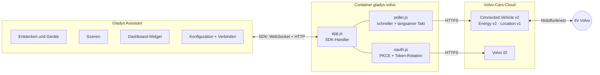
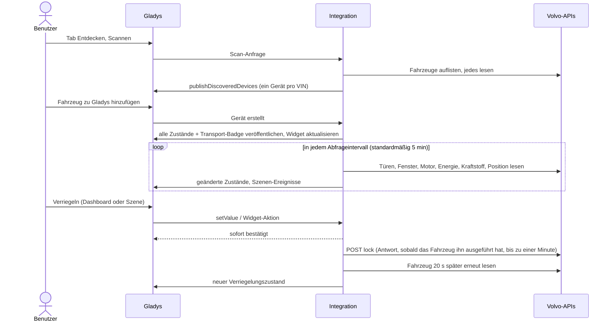
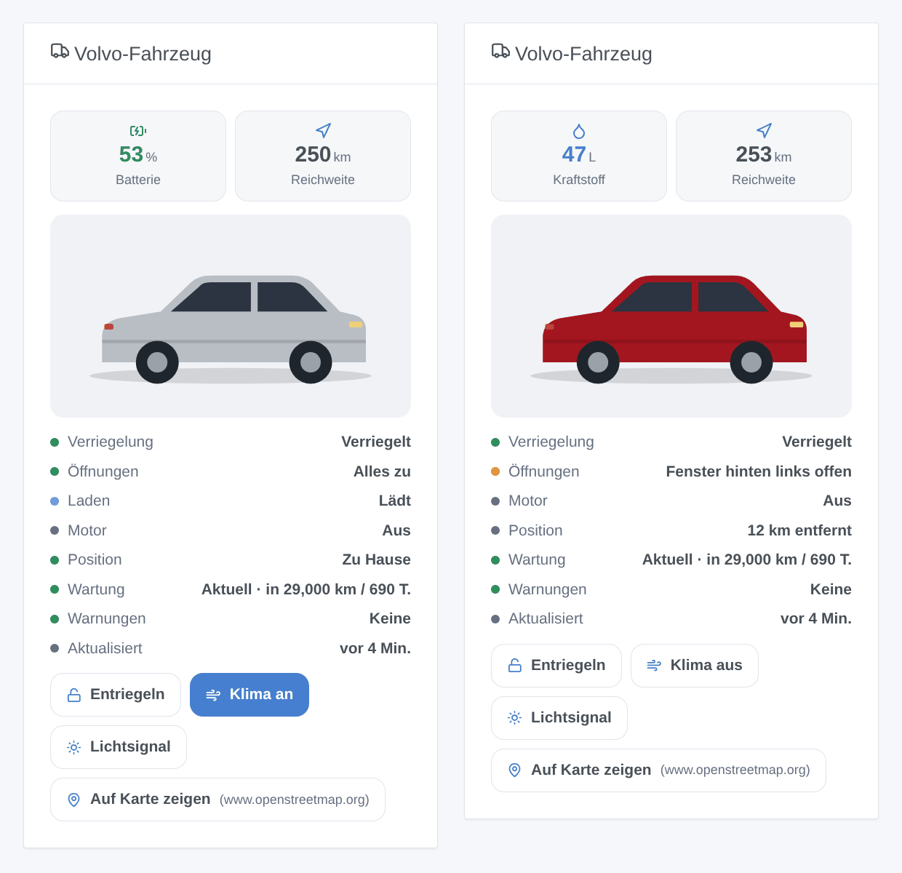
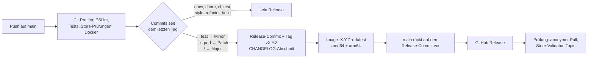

[English](README.md) · [Français](README.fr.md) · **Deutsch** · [Español](README.es.md)

[](LICENSE)
[](https://github.com/William-De71/gladys-volvo/releases)
[](https://github.com/William-De71/gladys-volvo/actions/workflows/release.yml)
[](https://gladysassistant.com)


# Gladys Volvo

Ihr **Volvo** in [Gladys Assistant](https://gladysassistant.com): Batterie oder Kraftstoff, Reichweite, Laden,
Verriegelung, Türen und Fenster, Klimatisierung, Position, Wartung und Warnungen, Szenen, die auf das Fahrzeug
reagieren, und ein Dashboard-Widget mit seinem Bild. Über die offiziellen
[Volvo-Cars-APIs](https://developer.volvocars.com/) (Connected Vehicle v2, Energy v2, Location v1), nach dem Vorbild
der `volvo`-Integration von Home Assistant.

Benutzerdokumentation, die Gladys anzeigt: [English](docs/en.md) · [Français](docs/fr.md) · [Deutsch](docs/de.md) ·
[Español](docs/es.md).

> Community-Integration, weder mit Volvo Cars verbunden noch von Volvo Cars unterstützt.

## Inhalt

- [Funktionen](#funktionen)
- [Architektur](#architektur)
- [Installation](#installation)
- [Konfiguration](#konfiguration)
- [Geräte](#geräte)
- [Cloud-Badge](#cloud-badge)
- [Szenen](#szenen)
- [Dashboard-Widget](#dashboard-widget)
- [Update von 1.0.x](#update-von-10x)
- [Fehlerbehebung](#fehlerbehebung)
- [Entwicklung](#entwicklung)
- [Release-Prozess](#release-prozess)
- [Mitwirken](#mitwirken)
- [Lizenz](#lizenz)

## Funktionen

- **Ein Gerät pro Fahrzeug** Ihrer Volvo ID, mit dem, was das Fahrzeug tatsächlich meldet: Batterie, elektrische
  Reichweite und Laden (Elektro- und Plug-in-Hybridfahrzeuge), Kraftstoff und Reichweite (Benzin, Diesel, Hybrid),
  Kilometerstand, Verriegelung (steuerbar, wenn das Fahrzeug es erlaubt), Türen, Heckklappe, Motorhaube, Fenster,
  Schiebedach, Fernklimatisierung, Wartung, Warnungen, Entfernung von zu Hause.
- **8 Szenen-Auslöser**: ver- oder entriegelt, verriegelt, aber offen, Motor gestartet oder gestoppt, Ladestatus,
  Ladekabel, zu Hause angekommen oder losgefahren, neue Warnung, erneute Anmeldung nötig. Jeder liefert eine
  versandfertige Zusammenfassung.
- **2 Szenen-Aktionen**: einen Befehl senden (verriegeln, entriegeln, Klimatisierung, Lichtsignal, Hupe, Motor) und den
  vollständigen Status lesen.
- **Ein Dashboard-Widget**: das Bild Ihres Fahrzeugs (genaues Modell und Farbe), Batterie oder Kraftstoff, Reichweite,
  Öffnungen und Schnelltasten.
- **Cloud-Badge** an jedem Fahrzeug, mit dem Grund, wenn das Fahrzeug laut Volvo keine Fernbefehle ausführen kann.
- **Vier Sprachen**: Englisch, Französisch, Deutsch und Spanisch, für die Konfiguration, die Texte und die
  Dokumentation.

## Architektur




Vom Scan bis zum Befehl:



Volvo sendet nichts von sich aus: Die Integration liest die Fahrzeuge mit einem eigenen Timer (`should_poll: false`),
in zwei Takten wie die Coordinators von Home Assistant:

- **schnell**, alle `poll_interval` (standardmäßig 5 min): Türen, Fenster, Motorstatus, Bordcomputer, Energy-Status,
  Kraftstoff, Position;
- **langsam**, alle 30 Minuten: Kilometerstand, Diagnose, Warnungen, Reifen, Bremsen, Motor, Verfügbarkeit der Befehle.

Etwa 6–7 Aufrufe pro Fahrzeug und schneller Runde, ~2.000 pro Tag bei 5 Minuten. Eine fehlschlagende Ressource behält
ihre letzte Antwort; ein 429 pausiert die Runden für mindestens 15 Minuten (oder `Retry-After`); ein 401 nach einer
Token-Erneuerung bedeutet einen abgelehnten API-Schlüssel, kein Anmeldeproblem. Die Antwortformate stammen aus den
aufgezeichneten Tests von Home Assistant (`test/fixtures/home-assistant.json`, Apache-2.0).

## Installation

1. Öffnen Sie in Gladys (5.3.0 oder neuer) **Integrationen**, suchen Sie **Volvo** im Katalog und installieren Sie es.
2. Folgen Sie der [Benutzerdokumentation](docs/de.md): Erstellen und veröffentlichen Sie eine Anwendung im
   Volvo-Entwicklerportal (etwa zehn Minuten, einmalig), geben Sie ihren Schlüssel und Client ein, klicken Sie dann auf
   **Verbinden** und melden Sie sich mit Ihrer Volvo ID an.
3. Fügen Sie im Tab **Entdecken** Ihr Fahrzeug hinzu.

Kompatible Fahrzeuge: Modelle ab 2010, bei denen die Volvo Cars App funktioniert, in den
[von den APIs abgedeckten Ländern](https://developer.volvocars.com/terms-and-conditions/apis-supported-locations/).

## Konfiguration

| Schlüssel       | Typ      | Hinweise                                                                     |
| --------------- | -------- | ---------------------------------------------------------------------------- |
| `api_key`       | `secret` | VCC API key der Anwendung im Entwicklerportal                                |
| `client_id`     | `string` | OAuth2-Client der veröffentlichten Anwendung                                 |
| `client_secret` | `secret` |                                                                              |
| `volvo_account` | `oauth2` | Anmeldung mit der Volvo ID (Autorisierungscode + PKCE)                       |
| `poll_interval` | `number` | schneller Takt, 2–60 min, Standard 5                                         |
| `home_radius`   | `number` | 50–5000 m, Standard 200                                                      |
| `language`      | `select` | Sprache der Texte: `auto` (letzte Dashboard-Sprache), `en`, `fr`, `de`, `es` |

Interne Schlüssel (außerhalb des Schemas): `access_token`, `refresh_token`, `token_expires_at`, `oauth_state`,
`oauth_code_verifier`, `last_language`. Aktionen des Manifests: `test_connection`, `refresh`, `disconnect`.

**Anmeldung.** Die Redirect URI ist die von Gladys angegebene (standardmäßig
`https://my.gladysassistant.com/redirect/oauth`, eine HTTPS-Seite, die den Browser zur Instanz zurückschickt: Volvo
lehnt `http://` und `localhost` ab). Der State und der PKCE-Verifier werden gespeichert, sodass ein Neustart des
Containers zwischen „Verbinden“ und dem Callback nichts verliert. **Volvo rotiert den Refresh Token**: Jeder ist nur
einmal gültig, Erneuerungen laufen nie parallel, und die neuen Tokens werden vor der Verwendung gespeichert. Die
Autorisierung einer für den persönlichen Gebrauch veröffentlichten Anwendung ist zeitlich begrenzt: Sobald die
Erneuerung abgelehnt wird, pausiert das Lesen, der Status fordert zum erneuten Verbinden auf, und
`authorization_expired` wird einmal ausgelöst.

**Sprache.** Gladys sendet die Sprache des Benutzers weder mit einer Abfrage noch mit einer Szenen-Aktion. Gerätenamen,
Textzustände (Ladestatus, Warnungen) und Szenen-Zusammenfassungen folgen der Einstellung `language`; bei `auto` die
Sprache des letzten Dashboards, das das Widget angezeigt hat.

## Geräte

Eine Funktion wird nur angeboten, wenn das Fahrzeug ihren Wert meldet (ein Diesel erhält Kraftstoff und keine Batterie,
ein Fahrzeug ohne Schiebedach keine Schiebedach-Funktion):

| Funktion                                                                        | Kategorie / Typ                             | Hinweise                                                |
| ------------------------------------------------------------------------------- | ------------------------------------------- | ------------------------------------------------------- |
| Batterie, elektrische Reichweite, Energie in der Batterie                       | `electrical-vehicle-battery`                | Energie = Kapazität × Ladestand                         |
| Ladekabel angeschlossen, Ladeleistung                                           | `electrical-vehicle-charge`                 | Leistung in kW                                          |
| Ladeziel, Ladestrombegrenzung                                                   | `electrical-vehicle-charge` (nur lesend)    | die API kann sie nicht ändern                           |
| Ladestatus, Warnungen                                                           | `text` / `text`                             | lokalisierter Text                                      |
| Verbleibende Ladezeit, Zeit bis zur Wartung                                     | `duration` / `integer`                      | Minuten, Tage                                           |
| Kraftstoff                                                                      | `volume-sensor` / `decimal`                 | Liter                                                   |
| Kraftstoffreichweite, Entfernung bis zur Wartung, Entfernung von zu Hause       | `distance-sensor` / `decimal`               | km                                                      |
| Durchschnittsverbrauch                                                          | `electrical-vehicle-consumption`            | kWh/100 km                                              |
| Kilometerstand, Türen, Heckklappe, Motorhaube, Tankklappe, Fenster, Schiebedach | `electrical-vehicle-state`                  | 1 = offen                                               |
| Verriegelung                                                                    | `electrical-vehicle-command` / `lock`       | 1 = verriegelt; ein Befehl, wenn LOCK + UNLOCK gelistet |
| Klimatisierung                                                                  | `electrical-vehicle-climate` / `climate-on` | optimistisch, nach 30 min zurück auf 0                  |

Externe IDs: `ext:<selector>:vehicle:<VIN>[:<feature>]`, dauerhaft. Unbekannte Werte werden weggelassen, nie als 0
veröffentlicht. Nur geänderte Werte werden veröffentlicht (`publishChangedStates`), ein unveränderter Wert zusätzlich
jede Stunde, damit das Dashboard ihn nie als veraltet anzeigt. Beim Erstellen des Fahrzeugs in Gladys wird alles erneut
veröffentlicht.

## Cloud-Badge

Die Integration deklariert `transports: ["cloud"]` und veröffentlicht für jedes in Gladys erstellte Fahrzeug:

| Badge                           | Wann                                                                                                                                                                           |
| ------------------------------- | ------------------------------------------------------------------------------------------------------------------------------------------------------------------------------ |
| **Cloud**                       | Volvo antwortet für das Fahrzeug                                                                                                                                               |
| **Cloud**, orangefarbener Punkt | laut Volvo kann das Fahrzeug keine Fernbefehle ausführen: keine Verbindung, in Benutzung, Energiesparmodus, Software-Update (der Grund erscheint beim Überfahren mit der Maus) |
| **Nicht erreichbar**            | in der letzten Runde ist kein Aufruf für das Fahrzeug gelungen, oder Volvo hat die Autorisierung beendet                                                                       |

Ein überschrittenes Kontingent (429) lässt das Badge unverändert: Es sagt nichts über das Fahrzeug aus.

## Szenen

**Auslöser** (`scene_triggers`), alle nach Fahrzeug filterbar außer dem letzten:

| Schlüssel                    | Wird ausgelöst, wenn…                                       | Variablen (neben `vehicle_name`, `summary`) |
| ---------------------------- | ----------------------------------------------------------- | ------------------------------------------- |
| `lock_changed`               | ver- oder entriegelt (Filter: Zustand)                      | —                                           |
| `left_open`                  | verriegelt, während etwas offen ist                         | `openings`                                  |
| `engine_changed`             | Motor gestartet oder gestoppt (Filter: Zustand)             | —                                           |
| `charging_changed`           | Ladestatus geändert (Filter: Status)                        | `status_label`, `battery_level`, `range_km` |
| `charger_connection_changed` | Kabel ein- oder ausgesteckt (Filter: Zustand)               | `battery_level`                             |
| `home_changed`               | angekommen oder losgefahren (25 % Hysterese auf den Radius) | `distance_km`                               |
| `warning_raised`             | ein Ereignis pro neuer Warnung                              | `warning`, `warning_label`                  |
| `authorization_expired`      | Volvo hat die Autorisierung von Gladys beendet              | (nur `summary`)                             |

Die erste Abfrage nach einem Start dient als Referenz: Ein bereits entriegeltes Fahrzeug löst nichts aus. Volvo sendet
nichts von sich aus, daher reagiert eine Szene innerhalb des Abfrageintervalls. Beispiele: _verriegelt, aber offen_ →
Benachrichtigung mit `{{triggerEvent.data.summary}}`; _zu Hause angekommen_ → Tor öffnen; _erneute Anmeldung nötig_ →
Erinnerungsnachricht.

**Aktionen** (`scene_actions`):

- `send_command`: verriegeln, entriegeln, verriegeln mit reduzierter Überwachung, Klimatisierung starten/stoppen,
  hupen, Lichter blinken lassen, hupen und blinken, Motor starten (1–15 min) oder stoppen. Abgelehnt, wenn das Fahrzeug
  den Befehl nicht anbietet; wartet auf die Antwort von Volvo (Ausgaben `success`, `status`, `summary`).
- `get_status`: Verriegelung, Öffnungen, Batterie, Kraftstoff, Reichweiten, Laden, Motor, Kilometerstand, zu Hause,
  Position, Link zur Karte, Warnungen, Zusammenfassung; aus der letzten Abfrage oder einer neuen (`refresh`).

Hupe und Lichtsignal haben bei manchen Fahrzeugen die 12-V-Batterie entleert: Die Integration sendet sie nie von sich
aus.

## Dashboard-Widget

`vehicle` (**Volvo-Fahrzeug**): das Konfiguratorbild des Fahrzeugs (geliefert über `onWidgetGetImage`), Batterie oder
Kraftstoff und Reichweite, eine Statusliste (Verriegelung, Öffnungen, Laden, Motor, Position, Wartung, Warnungen, Alter
der Daten) und bis zu vier Tasten: Ver-/Entriegeln und Lichtsignal (beide mit Rückfrage), Klimatisierung, auf Karte
zeigen. Einstellungen: das Fahrzeug, Tasten anzeigen.



## Update von 1.0.x

- **Nichts ist erforderlich**: Fahrzeuge, Verlauf, Szenen und Widgets funktionieren weiter.
- **Optional**: Die Funktionen **Kraftstoffreichweite** und **Entfernung bis zur Wartung** hatten in Gladys weder
  Symbol noch Bezeichnung (`distance-sensor` + `integer`). Sie sind jetzt `decimal`, die Kombination, die Gladys
  anzeigt: Öffnen Sie den Tab **Entdecken** und klicken Sie bei dem Fahrzeug auf **Aktualisieren**. Die externen IDs
  bleiben gleich, Verlauf, Raum und Szenen bleiben also erhalten.
- Neue Einstellung **Sprache der Texte** (Standard: automatisch, wie bisher).
- Die Mindestversion von Gladys ändert sich nicht: 5.1.1.

## Fehlerbehebung

| Symptom                                                | Wahrscheinliche Ursache                                                                                                             |
| ------------------------------------------------------ | ----------------------------------------------------------------------------------------------------------------------------------- |
| Die Volvo-ID-Seite zeigt einen Fehler zur Redirect URI | die bei der Veröffentlichung angegebene Redirect URI stimmt nicht genau mit der von Gladys angezeigten überein                      |
| Die Volvo-ID-Seite lehnt die Scopes ab                 | bei der Veröffentlichung wurden nicht alle Scopes markiert                                                                          |
| „Volvo lehnt den API-Schlüssel oder einen Scope ab“    | VCC API key falsch kopiert oder Anwendung ohne die nötigen Scopes                                                                   |
| „Tageskontingent der Volvo-API erreicht“               | zu viele Anfragen für eine Anwendung: Intervall erhöhen oder eine Anwendung pro Fahrzeug                                            |
| „Volvo hat die Autorisierung beendet“                  | Ende des Autorisierungszeitraums der Anwendung: auf Verbinden klicken                                                               |
| Orangefarbener Punkt am Cloud-Badge                    | laut Volvo kann das Fahrzeug gerade keine Fernbefehle ausführen: Fahren Sie mit der Maus über das Badge, um den Grund zu lesen      |
| Texte in der falschen Sprache                          | **Sprache der Texte** einstellen; bei Automatisch gilt die Sprache des zuletzt geöffneten Dashboards                                |
| Die Integration fehlt im Katalog                       | [rejected.json](https://integration-store-storage.gladysassistant.com/rejected.json) prüfen; der Store indexiert einige Male am Tag |

Für einen Fehlerbericht öffnen Sie ein [Issue](https://github.com/William-De71/gladys-volvo/issues) mit den Versionen
von Gladys und der Integration, dem Fahrzeug (Modell, Baujahr, Antrieb, Land) und den Logs, idealerweise mit
`DEBUG=gladys-integration-sdk`.

## Entwicklung

```bash
npm install
npm test                 # node --test: unit tests, the whole app against the SDK's fake Gladys, the release script
npm run lint             # ESLint
npm run format:check     # Prettier
npx github:GladysAssistant/integration-store . --skip-image-check
docs/illustrations/render.sh   # Widget-Illustrationen (Chrome, ImageMagick, Pillow)
```

`index.js` verbindet nur das SDK; die Handler liegen in `src/app.js`, das `test/app.test.js` mit dem Fake-Gladys von
`@gladysassistant/integration-sdk/testing` (es prüft die entdeckten Geräte, Zustände und Transports wie die Host-API)
und einer Fake-Volvo-API steuert. `test/structure.test.js` vergleicht die Discovery-Struktur und die gespeicherten
Schlüssel mit `test/fixtures/discovery.baseline.json` (v1.0.0): Externe IDs sowie pro Funktion Kategorie, Typ,
Einheit, Min, Max und Schrittweite ändern sich nie ohne dokumentierte Migration. `test/i18n.test.js` prüft die vier
Sprachen.

Docker-Image: `ghcr.io/william-de71/gladys-volvo`, Multi-Arch (amd64, arm64), ohne Root, schreibgeschütztes
Root-Dateisystem, OCI-Labels und das Manifest als Label `io.gladysassistant.manifest`.

## Release-Prozess

Releases erfolgen automatisch, anhand der auf `main` gemergten [Conventional Commits](https://www.conventionalcommits.org/):



- Der **Titel des Pull Requests** wird zum Squash-Commit und dann zur Changelog-Zeile: Schreiben Sie ihn auf Englisch,
  als die Zeile, die die Benutzer lesen (`feat(widgets): add the charging time to the widget`). `pr-title.yml` prüft
  ihn.
- `CHANGELOG.md` wird generiert (Keep a Changelog): niemals von Hand bearbeiten.
- `main` erhält das Manifest mit der neuen Version erst, wenn dessen Image existiert: Der Store sieht nie eine Version,
  die er nicht pullen kann.
- Manueller Lauf (**Actions → Release → Run workflow**): `release-as` erzwingt eine Version, `dry-run` zeigt Version
  und Notes an, ohne etwas zu veröffentlichen.
- **Geschützter `main`**: Der Release-Job setzt `main` mit dem `GITHUB_TOKEN` auf den Release-Commit. Bei einer
  Branch-Protection-Regel oder einem Ruleset erlauben Sie GitHub Actions, sie zu umgehen (Settings → Rules → Bypass
  list), oder verwenden Sie ein GitHub-App-Token; andernfalls schlägt der Job `publish` fehl und erklärt, wie Sie von
  Hand abschließen.
- Das Docker-Paket muss **öffentlich** sein (Package settings → Change visibility), damit Gladys es pullen kann.

## Mitwirken

Issues und Pull Requests sind willkommen. Führen Sie vor dem Pushen `npm run format:check`, `npm run lint` und
`npm test` aus, halten Sie die vier Sprachen synchron (Manifest, `src/i18n.js`, `docs/*.md`, READMEs) und lesen Sie
[CLAUDE.md](CLAUDE.md) für die Projektregeln. Sicherheitsprobleme: siehe [SECURITY.md](SECURITY.md).

## Lizenz

[Apache-2.0](LICENSE). Siehe [NOTICE](NOTICE) für die Teile Dritter (Test-Fixtures von Home Assistant) und die
Volvo-Marken.
