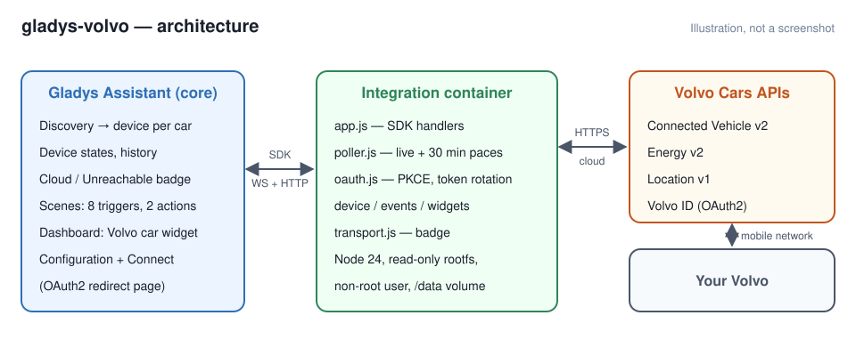
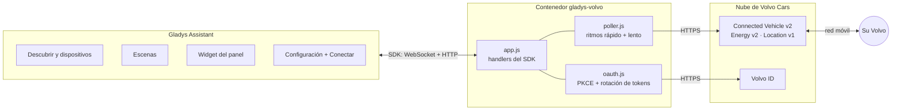
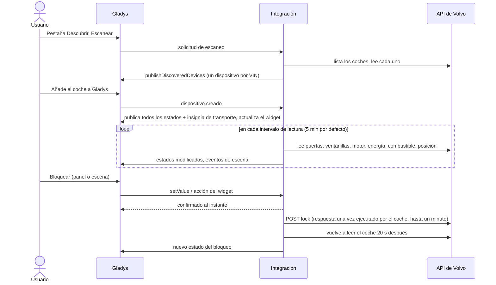
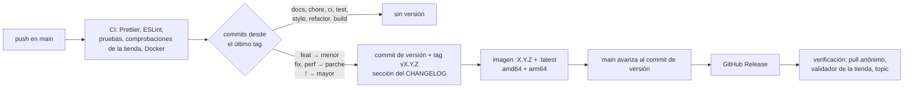

[English](README.md) · [Français](README.fr.md) · [Deutsch](README.de.md) · **Español**

[](LICENSE)
[](https://github.com/William-De71/gladys-volvo/releases)
[](https://github.com/William-De71/gladys-volvo/actions/workflows/release.yml)
[](https://gladysassistant.com)


# Gladys Volvo

Su **Volvo** en [Gladys Assistant](https://gladysassistant.com): batería o combustible, autonomía, carga, bloqueo,
puertas y ventanillas, climatización, posición, mantenimiento y alertas, escenas que reaccionan al coche y un widget
del panel con su foto. A través de las [API oficiales de Volvo Cars](https://developer.volvocars.com/) (Connected
Vehicle v2, Energy v2, Location v1), siguiendo el modelo de la integración `volvo` de Home Assistant.

Documentación de usuario, la que muestra Gladys: [English](docs/en.md) · [Français](docs/fr.md) · [Deutsch](docs/de.md)
· [Español](docs/es.md).

> Integración comunitaria, sin vínculo con Volvo Cars ni respaldada por Volvo Cars.

## Contenido

- [Funciones](#funciones)
- [Arquitectura](#arquitectura)
- [Instalación](#instalación)
- [Configuración](#configuración)
- [Dispositivos](#dispositivos)
- [Insignia Nube](#insignia-nube)
- [Escenas](#escenas)
- [Widget del panel](#widget-del-panel)
- [Actualización desde la 1.0.x](#actualización-desde-la-10x)
- [Solución de problemas](#solución-de-problemas)
- [Desarrollo](#desarrollo)
- [Proceso de publicación](#proceso-de-publicación)
- [Contribuir](#contribuir)
- [Licencia](#licencia)

## Funciones

- **Un dispositivo por coche** de su Volvo ID, con lo que el coche transmite realmente: batería, autonomía eléctrica y
  carga (eléctricos e híbridos enchufables), combustible y autonomía (gasolina, diésel, híbrido), cuentakilómetros,
  bloqueo (controlable cuando el coche lo permite), puertas, portón trasero, capó, ventanillas, techo solar,
  climatización a distancia, mantenimiento, alertas, distancia desde casa.
- **8 activadores de escena**: cerrado o abierto, cerrado pero abierto, motor arrancado o parado, estado de carga,
  cable de carga, llegada a casa o salida, nueva alerta, nuevo inicio de sesión necesario. Cada uno proporciona un
  resumen listo para enviar.
- **2 acciones de escena**: enviar un comando (bloquear, desbloquear, climatización, parpadeo de las luces, claxon,
  motor) y leer el estado completo.
- **Un widget del panel**: la foto de su coche (modelo y color exactos), batería o combustible, autonomía, aperturas y
  botones rápidos.
- **Insignia Nube** en cada coche, con el motivo cuando, según Volvo, el coche no puede ejecutar órdenes remotas.
- **Cuatro idiomas**: inglés, francés, alemán y español, para la configuración, los textos y la documentación.

## Arquitectura





Del escaneo a un comando:



Volvo no envía nada por sí mismo: la integración lee los coches con su propio temporizador (`should_poll: false`), a
dos ritmos como los coordinadores de Home Assistant:

- **rápido**, cada `poll_interval` (5 min por defecto): puertas, ventanillas, estado del motor, ordenador de a bordo,
  estado Energy, combustible, posición;
- **lento**, cada 30 minutos: cuentakilómetros, diagnóstico, alertas, neumáticos, frenos, motor, disponibilidad de los
  comandos.

Unas 6–7 llamadas por coche y por ronda rápida, ~2000 al día a 5 minutos. Un recurso que falla conserva su última
respuesta; un 429 pausa las rondas durante al menos 15 minutos (o `Retry-After`); un 401 tras renovar el token
significa una clave de API rechazada, no un problema de inicio de sesión. Los formatos de respuesta proceden de las
pruebas grabadas de Home Assistant (`test/fixtures/home-assistant.json`, Apache-2.0).

## Instalación

1. En Gladys (5.3.0 o posterior), abra **Integraciones**, busque **Volvo** en el catálogo e instálela.
2. Siga la [documentación de usuario](docs/es.md): cree y publique una aplicación en el portal de desarrolladores de
   Volvo (unos diez minutos, una sola vez), introduzca su clave y su cliente, haga clic en **Conectar** e inicie sesión
   con su Volvo ID.
3. En la pestaña **Descubrir**, añada su coche.

Coches compatibles: modelos desde 2010 cuya aplicación Volvo Cars funcione, en los
[países cubiertos por las API](https://developer.volvocars.com/terms-and-conditions/apis-supported-locations/).

## Configuración

| Clave           | Tipo     | Notas                                                                          |
| --------------- | -------- | ------------------------------------------------------------------------------ |
| `api_key`       | `secret` | VCC API key de la aplicación del portal de desarrolladores                     |
| `client_id`     | `string` | cliente OAuth2 de la aplicación publicada                                      |
| `client_secret` | `secret` |                                                                                |
| `volvo_account` | `oauth2` | inicio de sesión con Volvo ID (código de autorización + PKCE)                  |
| `poll_interval` | `number` | ritmo rápido, 2–60 min, 5 por defecto                                          |
| `home_radius`   | `number` | 50–5000 m, 200 por defecto                                                     |
| `language`      | `select` | idioma de los textos: `auto` (último idioma del panel), `en`, `fr`, `de`, `es` |

Claves internas (fuera del esquema): `access_token`, `refresh_token`, `token_expires_at`, `oauth_state`,
`oauth_code_verifier`, `last_language`. Acciones del manifiesto: `test_connection`, `refresh`, `disconnect`.

**Inicio de sesión.** La URI de redirección es la que indica Gladys (`https://my.gladysassistant.com/redirect/oauth`
por defecto, una página HTTPS que devuelve el navegador a la instancia: Volvo rechaza `http://` y `localhost`). El
estado y el verificador PKCE se guardan, de modo que un reinicio del contenedor entre «Conectar» y el retorno no pierde
nada. **Volvo rota el refresh token**: cada uno es de un solo uso, las renovaciones nunca se ejecutan en paralelo y los
nuevos tokens se guardan antes de usarse. La autorización de una aplicación publicada para uso personal está limitada
en el tiempo: cuando se rechaza la renovación, la lectura se pausa, el estado pide volver a hacer clic en Conectar y
`authorization_expired` se dispara una vez.

**Idioma.** Gladys no envía el idioma del usuario con una lectura ni con una acción de escena. Los nombres de los
dispositivos, los estados de texto (estado de la carga, alertas) y los resúmenes de las escenas siguen el ajuste
`language`; en `auto`, el idioma del último panel que mostró el widget.

## Dispositivos

Una función solo se ofrece si el coche transmite su valor (un diésel tiene combustible y no batería, un coche sin
techo solar no tiene la función de techo solar):

| Función                                                                                      | Categoría / tipo                            | Notas                                              |
| -------------------------------------------------------------------------------------------- | ------------------------------------------- | -------------------------------------------------- |
| Batería, autonomía eléctrica, energía en la batería                                          | `electrical-vehicle-battery`                | energía = capacidad × nivel                        |
| Cable de carga enchufado, potencia de carga                                                  | `electrical-vehicle-charge`                 | potencia en kW                                     |
| Objetivo de carga, límite de la corriente de carga                                           | `electrical-vehicle-charge` (solo lectura)  | la API no permite modificarlos                     |
| Estado de la carga, alertas                                                                  | `text` / `text`                             | texto traducido                                    |
| Tiempo de carga restante, tiempo hasta el mantenimiento                                      | `duration` / `integer`                      | minutos, días                                      |
| Combustible                                                                                  | `volume-sensor` / `decimal`                 | litros                                             |
| Autonomía de combustible, distancia hasta el mantenimiento, distancia desde casa             | `distance-sensor` / `decimal`               | km                                                 |
| Consumo medio                                                                                | `electrical-vehicle-consumption`            | kWh/100 km                                         |
| Cuentakilómetros, puertas, portón trasero, capó, tapa del depósito, ventanillas, techo solar | `electrical-vehicle-state`                  | 1 = abierto                                        |
| Bloqueo                                                                                      | `electrical-vehicle-command` / `lock`       | 1 = bloqueado; un comando si LOCK + UNLOCK figuran |
| Climatización                                                                                | `electrical-vehicle-climate` / `climate-on` | optimista, vuelve a 0 al cabo de 30 min            |

Identificadores externos: `ext:<selector>:vehicle:<VIN>[:<feature>]`, definitivos. Los valores desconocidos se omiten,
nunca se publican como 0. Solo se publican los valores modificados (`publishChangedStates`), y un valor sin cambios se
vuelve a publicar cada hora para que el panel nunca lo muestre como desactualizado. Todo se vuelve a publicar cuando
el coche se crea en Gladys.

## Insignia Nube

La integración declara `transports: ["cloud"]` y publica, para cada coche creado en Gladys:

| Insignia                | Cuándo                                                                                                                                                            |
| ----------------------- | ----------------------------------------------------------------------------------------------------------------------------------------------------------------- |
| **Nube**                | Volvo responde por el coche                                                                                                                                       |
| **Nube**, punto naranja | según Volvo, el coche no puede ejecutar órdenes remotas: sin conexión, en uso, ahorro de energía, actualización de software (el motivo aparece al pasar el ratón) |
| **Inaccesible**         | ninguna llamada para el coche tuvo éxito en la última ronda, o Volvo ha revocado la autorización                                                                  |

Una cuota superada (429) deja la insignia como estaba: no dice nada del coche.

## Escenas

**Activadores** (`scene_triggers`), todos filtrables por coche salvo el último:

| Clave                        | Se dispara cuando…                                    | Variables (además de `vehicle_name`, `summary`) |
| ---------------------------- | ----------------------------------------------------- | ----------------------------------------------- |
| `lock_changed`               | bloqueado o desbloqueado (filtro: estado)             | —                                               |
| `left_open`                  | bloqueado mientras algo está abierto                  | `openings`                                      |
| `engine_changed`             | motor arrancado o parado (filtro: estado)             | —                                               |
| `charging_changed`           | estado de carga modificado (filtro: estado)           | `status_label`, `battery_level`, `range_km`     |
| `charger_connection_changed` | cable conectado o desconectado (filtro: estado)       | `battery_level`                                 |
| `home_changed`               | llegada o salida (histéresis del 25 % sobre el radio) | `distance_km`                                   |
| `warning_raised`             | un evento por cada nueva alerta                       | `warning`, `warning_label`                      |
| `authorization_expired`      | Volvo ha puesto fin a la autorización de Gladys       | (solo `summary`)                                |

La primera lectura tras un inicio sirve de referencia: un coche ya desbloqueado no dispara nada. Volvo no envía nada
por sí mismo, así que una escena reacciona dentro del intervalo de lectura. Ejemplos: _cerrado pero abierto_ →
notificación con `{{triggerEvent.data.summary}}`; _llegada a casa_ → abrir el portón; _nuevo inicio de sesión
necesario_ → mensaje de recordatorio.

**Acciones** (`scene_actions`):

- `send_command`: bloquear, desbloquear, bloquear con vigilancia reducida, encender/apagar la climatización, tocar el
  claxon, hacer parpadear las luces, claxon y luces, arrancar el motor (1–15 min) o pararlo. Se rechaza si el coche no
  lo ofrece; espera la respuesta de Volvo (salidas `success`, `status`, `summary`).
- `get_status`: bloqueo, aperturas, batería, combustible, autonomías, carga, motor, cuentakilómetros, en casa, posición,
  enlace al mapa, alertas, resumen; a partir de la última lectura o de una nueva (`refresh`).

El claxon y el parpadeo de las luces han descargado la batería de 12 V de algunos coches: la integración nunca los
envía por sí misma.

## Widget del panel

`vehicle` (**Coche Volvo**): la imagen del configurador del coche (servida mediante `onWidgetGetImage`), batería o
combustible y autonomía, una lista de estados (bloqueo, aperturas, carga, motor, posición, mantenimiento, alertas,
antigüedad de los datos) y hasta cuatro botones: bloquear/desbloquear y ráfaga de luces (ambos piden confirmación),
climatización, ver en el mapa. Ajustes: el coche, mostrar los botones.


## Actualización desde la 1.0.x

- **No hace falta nada**: coches, historial, escenas y widgets siguen funcionando.
- **Opcional**: las funciones **Autonomía de combustible** y **Distancia hasta el mantenimiento** no tenían icono ni
  etiqueta en Gladys (`distance-sensor` + `integer`). Ahora son `decimal`, la combinación que Gladys muestra: abra la
  pestaña **Descubrir** y haga clic en **Actualizar** en el coche. Los identificadores externos no cambian, así que se
  conservan el historial, la habitación y las escenas.
- Nuevo ajuste **Idioma de los textos** (por defecto: automático, como antes).
- La versión mínima de Gladys no cambia: 5.1.1.

## Solución de problemas

| Síntoma                                                | Causa probable                                                                                                                      |
| ------------------------------------------------------ | ----------------------------------------------------------------------------------------------------------------------------------- |
| La página de Volvo ID muestra un error de Redirect URI | la Redirect URI declarada al publicar no coincide exactamente con la que muestra Gladys                                             |
| La página de Volvo ID rechaza los scopes               | no se marcaron todos los scopes al publicar                                                                                         |
| «Volvo rechaza la clave de API o un scope»             | VCC API key mal copiada, o aplicación sin los scopes necesarios                                                                     |
| «Cuota diaria de la API de Volvo alcanzada»            | demasiadas solicitudes para una sola aplicación: aumente el intervalo, o una aplicación por coche                                   |
| «Volvo ha revocado la autorización»                    | fin del periodo de autorización de la aplicación: haga clic en Conectar                                                             |
| Punto naranja en la insignia Nube                      | según Volvo, el coche no puede ejecutar órdenes remotas en este momento: pase el ratón sobre la insignia para ver el motivo         |
| Textos en el idioma equivocado                         | ajuste **Idioma de los textos**; en Automático, prevalece el idioma del último panel abierto                                        |
| La integración no aparece en el catálogo               | consulte [rejected.json](https://integration-store-storage.gladysassistant.com/rejected.json); la tienda indexa varias veces al día |

Para informar de un error, abra una [issue](https://github.com/William-De71/gladys-volvo/issues) con las versiones de
Gladys y de la integración, el coche (modelo, año, motorización, país) y los registros, idealmente con
`DEBUG=gladys-integration-sdk`.

## Desarrollo

```bash
npm install
npm test                 # node --test: unit tests, the whole app against the SDK's fake Gladys, the release script
npm run lint             # ESLint
npm run format:check     # Prettier
npx github:GladysAssistant/integration-store . --skip-image-check
docs/illustrations/render.sh   # ilustraciones del widget (Chrome, ImageMagick, Pillow)
```

`index.js` solo conecta el SDK; los handlers están en `src/app.js`, que `test/app.test.js` controla con el Gladys
simulado de `@gladysassistant/integration-sdk/testing` (comprueba los dispositivos descubiertos, los estados y los
transportes como la API del host) y una API de Volvo simulada. `test/structure.test.js` compara la estructura de
descubrimiento y las claves guardadas con `test/fixtures/discovery.baseline.json` (v1.0.0): los identificadores
externos y, por función, la categoría, el tipo, la unidad, el mínimo, el máximo y el paso nunca cambian sin una
migración documentada. `test/i18n.test.js` comprueba los cuatro idiomas.

Imagen Docker: `ghcr.io/william-de71/gladys-volvo`, multiarquitectura (amd64, arm64), sin root, sistema de archivos
raíz de solo lectura, etiquetas OCI y el manifiesto como etiqueta `io.gladysassistant.manifest`.

## Proceso de publicación

Las versiones se publican automáticamente a partir de los [Conventional Commits](https://www.conventionalcommits.org/)
fusionados en `main`:



- El **título de la pull request** se convierte en el commit squash y luego en la línea del changelog: escríbalo en
  inglés, como la línea que leerán los usuarios (`feat(widgets): add the charging time to the widget`). `pr-title.yml`
  lo comprueba.
- `CHANGELOG.md` se genera (Keep a Changelog): no lo edite nunca a mano.
- `main` solo recibe el manifiesto con la nueva versión una vez que su imagen existe: la tienda nunca ve una versión
  que no pueda descargar.
- Ejecución manual (**Actions → Release → Run workflow**): `release-as` fuerza una versión, `dry-run` muestra la
  versión y las notas sin publicar nada.
- **`main` protegida**: el job de publicación avanza `main` al commit de versión con el `GITHUB_TOKEN`. Con una regla
  de protección de rama o un ruleset, permita que GitHub Actions la omita (Settings → Rules → Bypass list), o use un
  token de GitHub App; de lo contrario, el job `publish` falla e indica cómo terminar a mano.
- El paquete Docker debe ser **público** (Package settings → Change visibility) para que Gladys pueda descargarlo.

## Contribuir

Las issues y las pull requests son bienvenidas. Ejecute `npm run format:check`, `npm run lint` y `npm test` antes de
hacer push, mantenga los cuatro idiomas sincronizados (manifiesto, `src/i18n.js`, `docs/*.md`, README) y lea
[CLAUDE.md](CLAUDE.md) para las reglas del proyecto. Problemas de seguridad: consulte [SECURITY.md](SECURITY.md).

## Licencia

[Apache-2.0](LICENSE). Consulte [NOTICE](NOTICE) para las partes de terceros (fixtures de prueba de Home Assistant) y
las marcas de Volvo.
