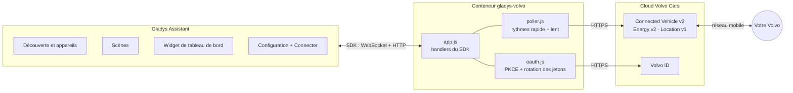
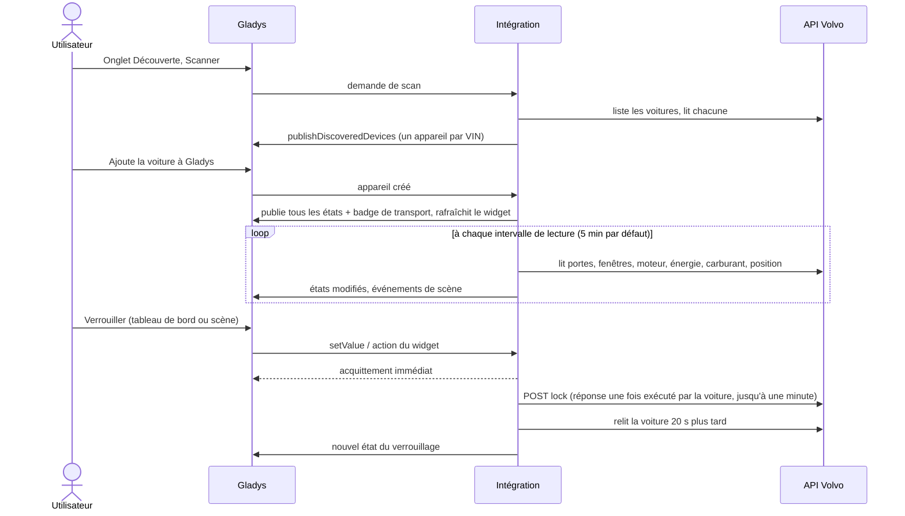
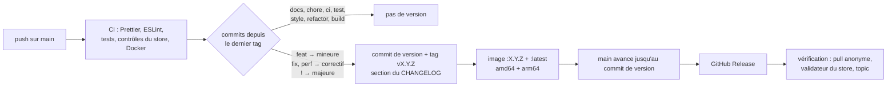

[English](README.md) · **Français** · [Deutsch](README.de.md) · [Español](README.es.md)

[](LICENSE)
[](https://github.com/William-De71/gladys-volvo/releases)
[](https://github.com/William-De71/gladys-volvo/actions/workflows/release.yml)
[](https://gladysassistant.com)


# Gladys Volvo

Votre **Volvo** dans [Gladys Assistant](https://gladysassistant.com) : batterie ou carburant, autonomie, charge,
verrouillage, portes et fenêtres, climatisation, position, entretien et alertes, des scènes qui réagissent à la voiture
et un widget de tableau de bord avec sa photo. Via les [API officielles de Volvo Cars](https://developer.volvocars.com/)
(Connected Vehicle v2, Energy v2, Location v1), sur le modèle de l'intégration `volvo` de Home Assistant.

Documentation utilisateur, celle que Gladys affiche : [English](docs/en.md) · [Français](docs/fr.md) ·
[Deutsch](docs/de.md) · [Español](docs/es.md).

> Intégration communautaire, sans lien avec Volvo Cars ni approuvée par Volvo Cars.

## Sommaire

- [Fonctionnalités](#fonctionnalités)
- [Architecture](#architecture)
- [Installation](#installation)
- [Configuration](#configuration)
- [Appareils](#appareils)
- [Badge Cloud](#badge-cloud)
- [Scènes](#scènes)
- [Widget de tableau de bord](#widget-de-tableau-de-bord)
- [Mise à jour depuis la 1.0.x](#mise-à-jour-depuis-la-10x)
- [Dépannage](#dépannage)
- [Développement](#développement)
- [Processus de publication](#processus-de-publication)
- [Contribuer](#contribuer)
- [Licence](#licence)

## Fonctionnalités

- **Un appareil par voiture** de votre Volvo ID, avec ce que la voiture transmet réellement : batterie, autonomie
  électrique et charge (électriques et hybrides rechargeables), carburant et autonomie (essence, diesel, hybride),
  kilométrage, verrouillage (pilotable quand la voiture le permet), portes, hayon, capot, fenêtres, toit ouvrant,
  climatisation à distance, entretien, alertes, distance du domicile.
- **8 déclencheurs de scène** : verrouillée ou déverrouillée, verrouillée mais ouverte, moteur démarré ou arrêté, état
  de la charge, câble de charge, arrivée ou départ de la maison, nouvelle alerte, reconnexion nécessaire. Chacun fournit
  un résumé prêt à envoyer.
- **2 actions de scène** : envoyer une commande (verrouiller, déverrouiller, climatisation, clignotement des feux,
  klaxon, moteur) et lire l'état complet.
- **Un widget de tableau de bord** : la photo de votre voiture (modèle et couleur exacts), batterie ou carburant,
  autonomie, ouvrants et boutons rapides.
- **Badge Cloud** sur chaque voiture, avec la raison quand Volvo indique que la voiture ne peut pas exécuter de
  commandes à distance.
- **Quatre langues** : anglais, français, allemand et espagnol, pour la configuration, les textes et la documentation.

## Architecture




Du scan à une commande :



Volvo ne pousse rien : l'intégration lit les voitures selon sa propre minuterie (`should_poll: false`), à deux rythmes
comme les coordinateurs de Home Assistant :

- **rapide**, à chaque `poll_interval` (5 min par défaut) : portes, fenêtres, état du moteur, ordinateur de bord, état
  Energy, carburant, position ;
- **lent**, toutes les 30 minutes : kilométrage, diagnostics, alertes, pneus, freins, moteur, disponibilité des
  commandes.

Environ 6 à 7 requêtes par voiture et par tour rapide, soit ~2 000 par jour à 5 minutes. Une ressource en échec garde sa
dernière réponse ; un 429 suspend les tours pendant au moins 15 minutes (ou `Retry-After`) ; un 401 après un
renouvellement de jeton signifie une clé d'API refusée, pas un problème de connexion. Les formats de réponse proviennent
des tests enregistrés de Home Assistant (`test/fixtures/home-assistant.json`, Apache-2.0).

## Installation

1. Dans Gladys (5.1.1 ou ultérieure), ouvrez **Intégrations**, trouvez **Volvo** dans le catalogue et installez-la.
2. Suivez la [documentation utilisateur](docs/fr.md) : créez et publiez une application sur le portail développeur
   Volvo (une dizaine de minutes, une seule fois), saisissez sa clé et son client, puis cliquez sur **Connecter** et
   identifiez-vous avec votre Volvo ID.
3. Dans l'onglet **Découverte**, ajoutez votre voiture.

Voitures compatibles : modèles à partir de 2010 dont l'application Volvo Cars fonctionne, dans les
[pays couverts par les API](https://developer.volvocars.com/terms-and-conditions/apis-supported-locations/).

## Configuration

| Clé             | Type     | Remarques                                                                               |
| --------------- | -------- | --------------------------------------------------------------------------------------- |
| `api_key`       | `secret` | VCC API key de l'application du portail développeur                                     |
| `client_id`     | `string` | client OAuth2 de l'application publiée                                                  |
| `client_secret` | `secret` |                                                                                         |
| `volvo_account` | `oauth2` | connexion Volvo ID (code d'autorisation + PKCE)                                         |
| `poll_interval` | `number` | rythme rapide, 2 à 60 min, 5 par défaut                                                 |
| `home_radius`   | `number` | 50 à 5000 m, 200 par défaut                                                             |
| `language`      | `select` | langue des textes : `auto` (dernière langue du tableau de bord), `en`, `fr`, `de`, `es` |

Clés internes (hors schéma) : `access_token`, `refresh_token`, `token_expires_at`, `oauth_state`,
`oauth_code_verifier`, `last_language`. Actions du manifeste : `test_connection`, `refresh`, `disconnect`.

**Connexion.** L'URI de redirection est celle que donne Gladys (`https://my.gladysassistant.com/redirect/oauth` par
défaut, une page HTTPS qui renvoie le navigateur vers l'instance : Volvo refuse `http://` et `localhost`). L'état et le
vérificateur PKCE sont enregistrés : un redémarrage du conteneur entre Connecter et le retour ne fait rien perdre.
**Volvo fait tourner le refresh token** : chacun ne sert qu'une fois, les renouvellements ne sont jamais simultanés et
les nouveaux jetons sont enregistrés avant usage. L'autorisation d'une application publiée pour un usage personnel est
limitée dans le temps : une fois le renouvellement refusé, la lecture s'interrompt, le statut demande de cliquer de
nouveau sur Connecter et `authorization_expired` se déclenche une fois.

**Langue.** Gladys n'envoie pas la langue de l'utilisateur avec une lecture ou une action de scène. Les noms des
appareils, les états texte (état de la charge, alertes) et les résumés des scènes suivent le réglage `language` ; en
`auto`, la langue du dernier tableau de bord qui a affiché le widget.

## Appareils

Une fonctionnalité n'est proposée que si la voiture transmet sa valeur (une diesel a le carburant et pas de batterie,
une voiture sans toit ouvrant pas de fonctionnalité toit ouvrant) :

| Fonctionnalité                                                                | Catégorie / type                            | Remarques                                           |
| ----------------------------------------------------------------------------- | ------------------------------------------- | --------------------------------------------------- |
| Batterie, autonomie électrique, énergie dans la batterie                      | `electrical-vehicle-battery`                | énergie = capacité × niveau                         |
| Câble de charge branché, puissance de charge                                  | `electrical-vehicle-charge`                 | puissance en kW                                     |
| Objectif de charge, limite du courant de charge                               | `electrical-vehicle-charge` (lecture seule) | l'API ne permet pas de les modifier                 |
| État de la charge, alertes                                                    | `text` / `text`                             | texte localisé                                      |
| Temps de charge restant, délai avant l'entretien                              | `duration` / `integer`                      | minutes, jours                                      |
| Carburant                                                                     | `volume-sensor` / `decimal`                 | litres                                              |
| Autonomie carburant, distance avant l'entretien, distance du domicile         | `distance-sensor` / `decimal`               | km                                                  |
| Consommation moyenne                                                          | `electrical-vehicle-consumption`            | kWh/100 km                                          |
| Kilométrage, portes, hayon, capot, trappe à carburant, fenêtres, toit ouvrant | `electrical-vehicle-state`                  | 1 = ouvert                                          |
| Verrouillage                                                                  | `electrical-vehicle-command` / `lock`       | 1 = verrouillée ; commande si LOCK + UNLOCK listées |
| Climatisation                                                                 | `electrical-vehicle-climate` / `climate-on` | optimiste, revient à 0 au bout de 30 min            |

Identifiants externes : `ext:<selector>:vehicle:<VIN>[:<feature>]`, définitifs. Les valeurs inconnues sont omises,
jamais publiées à 0. Seules les valeurs modifiées sont publiées (`publishChangedStates`), et une valeur inchangée l'est
de nouveau toutes les heures pour que le tableau de bord ne l'affiche jamais comme périmée. Tout est publié de nouveau
quand la voiture est créée dans Gladys.

## Badge Cloud

L'intégration déclare `transports: ["cloud"]` et publie, pour chaque voiture créée dans Gladys :

| Badge                      | Quand                                                                                                                                                                                            |
| -------------------------- | ------------------------------------------------------------------------------------------------------------------------------------------------------------------------------------------------ |
| **Cloud**                  | Volvo répond pour la voiture                                                                                                                                                                     |
| **Cloud**, pastille orange | Volvo indique que la voiture ne peut pas exécuter de commandes à distance : pas de connexion, en cours d'utilisation, économie d'énergie, mise à jour logicielle (la raison s'affiche au survol) |
| **Injoignable**            | aucune requête pour la voiture n'a abouti lors du dernier tour, ou Volvo a mis fin à l'autorisation                                                                                              |

Un quota dépassé (429) laisse le badge tel quel : il ne dit rien de la voiture.

## Scènes

**Déclencheurs** (`scene_triggers`), tous filtrables par voiture sauf le dernier :

| Clé                          | Se déclenche quand…                                 | Variables (en plus de `vehicle_name`, `summary`) |
| ---------------------------- | --------------------------------------------------- | ------------------------------------------------ |
| `lock_changed`               | verrouillée ou déverrouillée (filtre : état)        | —                                                |
| `left_open`                  | verrouillée alors que quelque chose est ouvert      | `openings`                                       |
| `engine_changed`             | moteur démarré ou arrêté (filtre : état)            | —                                                |
| `charging_changed`           | état de la charge modifié (filtre : état)           | `status_label`, `battery_level`, `range_km`      |
| `charger_connection_changed` | câble branché ou débranché (filtre : état)          | `battery_level`                                  |
| `home_changed`               | arrivée ou départ (hystérésis de 25 % sur le rayon) | `distance_km`                                    |
| `warning_raised`             | un événement par nouvelle alerte                    | `warning`, `warning_label`                       |
| `authorization_expired`      | Volvo a mis fin à l'autorisation de Gladys          | (`summary` seulement)                            |

La première lecture après un démarrage sert de référence : une voiture déjà déverrouillée ne déclenche rien. Volvo ne
pousse rien, une scène réagit donc dans l'intervalle de lecture. Exemples : _verrouillée mais ouverte_ → notification
avec `{{triggerEvent.data.summary}}` ; _arrivée à la maison_ → ouvrir le portail ; _reconnexion nécessaire_ → message de
rappel.

**Actions** (`scene_actions`) :

- `send_command` : verrouiller, déverrouiller, verrouiller avec surveillance réduite, démarrer/arrêter la climatisation,
  klaxonner, faire clignoter les feux, klaxonner et clignoter, démarrer le moteur (1 à 15 min) ou l'arrêter. Refusée si
  la voiture ne la propose pas ; attend la réponse de Volvo (sorties `success`, `status`, `summary`).
- `get_status` : verrouillage, ouvrants, batterie, carburant, autonomies, charge, moteur, kilométrage, à la maison,
  position, lien vers la carte, alertes, résumé ; depuis la dernière lecture ou une lecture fraîche (`refresh`).

Le klaxon et le clignotement des feux ont déjà vidé la batterie 12 V de certaines voitures : l'intégration ne les envoie
jamais d'elle-même.

## Widget de tableau de bord

`vehicle` (**Voiture Volvo**) : la photo du configurateur de la voiture (servie par `onWidgetGetImage`), batterie ou
carburant et autonomie, une liste d'états (verrouillage, ouvrants, charge, moteur, position, entretien, alertes, âge des
données) et jusqu'à quatre boutons : verrouiller/déverrouiller et faire clignoter (tous deux avec confirmation),
climatisation, voir sur la carte. Réglages : la voiture, afficher les boutons.


## Mise à jour depuis la 1.0.x

- **Rien n'est nécessaire** : voitures, historique, scènes et widgets continuent de fonctionner.
- **Facultatif** : les fonctionnalités **Autonomie carburant** et **Distance avant l'entretien** n'avaient ni icône ni
  libellé dans Gladys (`distance-sensor` + `integer`). Elles sont désormais en `decimal`, la combinaison que Gladys
  affiche : ouvrez l'onglet **Découverte** et cliquez sur **Mettre à jour** sur la voiture. Les identifiants externes
  ne changent pas : historique, pièce et scènes sont conservés.
- Nouveau réglage **Langue des textes** (par défaut : automatique, comme avant).
- La version minimale de Gladys ne change pas : 5.1.1.

## Dépannage

| Symptôme                                            | Cause probable                                                                                                                          |
| --------------------------------------------------- | --------------------------------------------------------------------------------------------------------------------------------------- |
| La page Volvo ID affiche une erreur de redirect URI | l'URI de redirection déclarée lors de la publication ne correspond pas exactement à celle affichée par Gladys                           |
| La page Volvo ID refuse les scopes                  | tous les scopes n'ont pas été cochés lors de la publication                                                                             |
| « Volvo refuse la clé d'API »                       | VCC API key mal copiée, ou application sans les scopes nécessaires                                                                      |
| « Quota quotidien de l'API Volvo atteint »          | trop de requêtes pour une seule application : augmentez l'intervalle, ou une application par voiture                                    |
| « Volvo a mis fin à l'autorisation »                | fin de la période d'autorisation de l'application : cliquez sur Connecter                                                               |
| Pastille orange sur le badge Cloud                  | Volvo indique que la voiture ne peut pas exécuter de commandes à distance pour l'instant : survolez le badge pour lire la raison        |
| Textes dans la mauvaise langue                      | réglez **Langue des textes** ; en Automatique, c'est la langue du dernier tableau de bord ouvert qui l'emporte                          |
| L'intégration n'apparaît pas dans le catalogue      | consultez [rejected.json](https://integration-store-storage.gladysassistant.com/rejected.json) ; le store indexe quelques fois par jour |

Pour signaler un bug, ouvrez une [issue](https://github.com/William-De71/gladys-volvo/issues) avec les versions de
Gladys et de l'intégration, la voiture (modèle, année, motorisation, pays) et les journaux, idéalement avec
`DEBUG=gladys-integration-sdk`.

## Développement

```bash
npm install
npm test                 # node --test: unit tests, the whole app against the SDK's fake Gladys, the release script
npm run lint             # ESLint
npm run format:check     # Prettier
npx github:GladysAssistant/integration-store . --skip-image-check
docs/illustrations/render.sh   # illustrations du widget (Chrome, ImageMagick, Pillow)
```

`index.js` ne fait que brancher le SDK ; les handlers sont dans `src/app.js`, que `test/app.test.js` pilote avec le faux
Gladys de `@gladysassistant/integration-sdk/testing` (il vérifie les appareils découverts, les états et les transports
comme l'API hôte) et une fausse API Volvo. `test/structure.test.js` compare la structure de découverte et les clés
enregistrées avec `test/fixtures/discovery.baseline.json` (v1.0.0) : les identifiants externes et, par fonctionnalité,
la catégorie, le type, l'unité, le min, le max et le pas ne changent jamais sans migration documentée.
`test/i18n.test.js` vérifie les quatre langues.

Image Docker : `ghcr.io/william-de71/gladys-volvo`, multi-architecture (amd64, arm64), non-root, système de fichiers
racine en lecture seule, labels OCI et le manifeste dans le label `io.gladysassistant.manifest`.

## Processus de publication

Les versions sont publiées automatiquement, à partir des [Conventional Commits](https://www.conventionalcommits.org/)
fusionnés sur `main` :



- Le **titre de la pull request** devient le commit squash, puis la ligne du changelog : rédigez-le en anglais, comme
  la ligne que liront les utilisateurs (`feat(widgets): add the charging time to the widget`). `pr-title.yml` le
  vérifie.
- `CHANGELOG.md` est généré (Keep a Changelog) : ne le modifiez jamais à la main.
- `main` ne reçoit le manifeste à la nouvelle version qu'une fois son image disponible : le store ne voit jamais une
  version qu'il ne peut pas récupérer.
- Exécution manuelle (**Actions → Release → Run workflow**) : `release-as` force une version, `dry-run` affiche la
  version et les notes sans rien publier.
- **`main` protégée** : le job de publication avance `main` jusqu'au commit de version avec le `GITHUB_TOKEN`. Avec une
  règle de protection de branche ou un ruleset, autorisez GitHub Actions à la contourner (Settings → Rules → Bypass
  list), ou utilisez un jeton de GitHub App ; sinon le job `publish` échoue et indique comment terminer à la main.
- Le package Docker doit être **public** (Package settings → Change visibility) pour que Gladys puisse le récupérer.

## Contribuer

Les issues et les pull requests sont les bienvenues. Lancez `npm run format:check`, `npm run lint` et `npm test` avant
de pousser, gardez les quatre langues synchronisées (manifeste, `src/i18n.js`, `docs/*.md`, README) et lisez
[CLAUDE.md](CLAUDE.md) pour les règles du projet. Problèmes de sécurité : voir [SECURITY.md](SECURITY.md).

## Licence

[Apache-2.0](LICENSE). Voir [NOTICE](NOTICE) pour les parties tierces (fixtures de test de Home Assistant) et les
marques Volvo.
