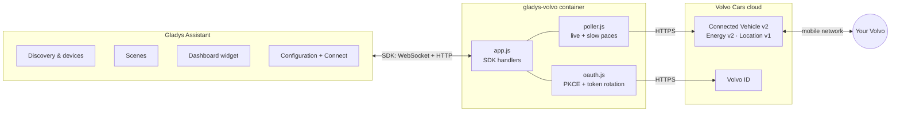
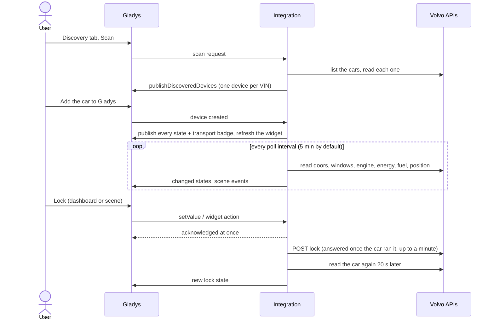
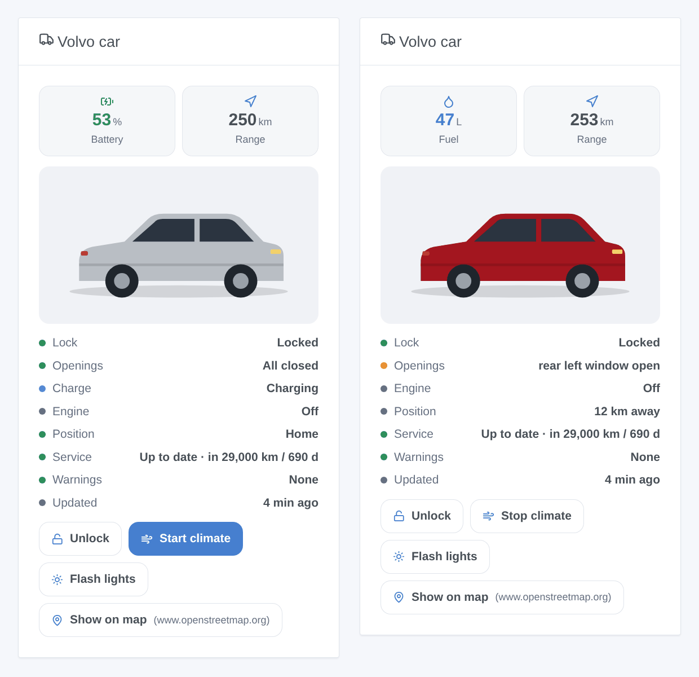
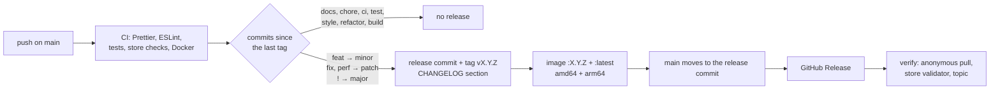

**English** · [Français](README.fr.md) · [Deutsch](README.de.md) · [Español](README.es.md)

[](LICENSE)
[](https://github.com/William-De71/gladys-volvo/releases)
[](https://github.com/William-De71/gladys-volvo/actions/workflows/release.yml)
[](https://gladysassistant.com)


# Gladys Volvo

Your **Volvo** in [Gladys Assistant](https://gladysassistant.com): battery or fuel, range, charging, lock, doors and
windows, climate, position, service and warnings, scenes that react to the car and a dashboard widget with its
picture. Through the official [Volvo Cars APIs](https://developer.volvocars.com/) (Connected Vehicle v2, Energy v2,
Location v1), modeled on Home Assistant's `volvo` integration.

User documentation, the one Gladys shows: [English](docs/en.md) · [Français](docs/fr.md) · [Deutsch](docs/de.md) ·
[Español](docs/es.md).

> Community integration, not affiliated with or endorsed by Volvo Cars.

## Contents

- [Features](#features)
- [Architecture](#architecture)
- [Installation](#installation)
- [Configuration](#configuration)
- [Devices](#devices)
- [Cloud badge](#cloud-badge)
- [Scenes](#scenes)
- [Dashboard widget](#dashboard-widget)
- [Updating from 1.0.x](#updating-from-10x)
- [Troubleshooting](#troubleshooting)
- [Development](#development)
- [Release process](#release-process)
- [Contributing](#contributing)
- [License](#license)

## Features

- **A device per car** of your Volvo ID, with what the car really reports: battery, electric range and charging
  (electric and plug-in hybrid), fuel and range (petrol, diesel, hybrid), odometer, lock (controllable when the car
  allows it), doors, tailgate, hood, windows, sunroof, remote climate, service, warnings, distance from home.
- **8 scene triggers**: locked or unlocked, locked but left open, engine started or stopped, charging status,
  charging cable, arrived home or left, new warning, sign-in to renew. Each one gives a summary ready to send.
- **2 scene actions**: send a command (lock, unlock, climate, flash, honk, engine) and read the full status.
- **A dashboard widget**: the picture of your car (exact model and colour), battery or fuel, range, openings and
  quick buttons.
- **Cloud badge** on each car, with the reason when Volvo says the car cannot run remote commands.
- **Four languages**: English, French, German and Spanish, for the configuration, the texts and the docs.

## Architecture




From the scan to a command:



Volvo pushes nothing: the integration reads the cars on its own timer (`should_poll: false`), at two paces like
Home Assistant's coordinators:

- **live**, every `poll_interval` (5 min by default): doors, windows, engine status, trip computer, Energy state,
  fuel, position;
- **slow**, every 30 minutes: odometer, diagnostics, warnings, tyres, brakes, engine, command availability.

About 6–7 calls per car per live round, ~2,000 a day at 5 minutes. A failing resource keeps its last answer; a 429
pauses the rounds for at least 15 minutes (or `Retry-After`); a 401 after a token refresh means a refused API key,
not a sign-in problem. Response shapes come from Home Assistant's recorded tests
(`test/fixtures/home-assistant.json`, Apache-2.0).

## Installation

1. In Gladys (5.3.0 or later), open **Integrations**, find **Volvo** in the catalog and install it.
2. Follow the [user documentation](docs/en.md): create and publish an application on the Volvo developer portal
   (about ten minutes, once), enter its key and client, then click **Connect** and sign in with your Volvo ID.
3. In the **Discovery** tab, add your car.

Compatible cars: models from 2010 on whose Volvo Cars app works, in the
[countries covered by the APIs](https://developer.volvocars.com/terms-and-conditions/apis-supported-locations/).

## Configuration

| Key             | Type     | Notes                                                                           |
| --------------- | -------- | ------------------------------------------------------------------------------- |
| `api_key`       | `secret` | VCC API key of the developer portal application                                 |
| `client_id`     | `string` | OAuth2 client of the published application                                      |
| `client_secret` | `secret` |                                                                                 |
| `volvo_account` | `oauth2` | Volvo ID sign-in (authorization code + PKCE)                                    |
| `poll_interval` | `number` | live pace, 2–60 min, default 5                                                  |
| `home_radius`   | `number` | 50–5000 m, default 200                                                          |
| `language`      | `select` | language of the texts: `auto` (last dashboard language), `en`, `fr`, `de`, `es` |

Internal keys (outside the schema): `access_token`, `refresh_token`, `token_expires_at`, `oauth_state`,
`oauth_code_verifier`, `last_language`. Manifest actions: `test_connection`, `refresh`, `disconnect`.

**Sign-in.** The redirect URI is the one Gladys gives (`https://my.gladysassistant.com/redirect/oauth` by default,
an HTTPS page that sends the browser back to the instance: Volvo refuses `http://` and `localhost`). The state and
the PKCE verifier are stored, so a container restart between Connect and the callback loses nothing. **Volvo
rotates the refresh token**: each one is single-use, refreshes are single-flight and the new tokens are stored
before use. The grant of a personally published application is limited in time: once the refresh is refused,
reading pauses, the status asks to Connect again and `authorization_expired` fires once.

**Language.** Gladys does not send the user's language with a poll or a scene action. Device names, text states
(charging status, warnings) and scene summaries use the `language` setting; in `auto`, the language of the last
dashboard that showed the widget.

## Devices

A feature is offered only when the car reports its value (a diesel gets fuel and no battery, a car without a
sunroof no sunroof feature):

| Feature                                                     | Category / type                             | Notes                                           |
| ----------------------------------------------------------- | ------------------------------------------- | ----------------------------------------------- |
| Battery, electric range, energy                             | `electrical-vehicle-battery`                | energy = capacity × level                       |
| Plugged, charging power                                     | `electrical-vehicle-charge`                 | power in kW                                     |
| Charge target, current limit                                | `electrical-vehicle-charge` (read-only)     | the API cannot change them                      |
| Charging status, warnings                                   | `text` / `text`                             | localized text                                  |
| Charging time left, time to service                         | `duration` / `integer`                      | minutes, days                                   |
| Fuel                                                        | `volume-sensor` / `decimal`                 | liters                                          |
| Fuel range, distance to service, distance from home         | `distance-sensor` / `decimal`               | km                                              |
| Average consumption                                         | `electrical-vehicle-consumption`            | kWh/100 km                                      |
| Odometer, doors, tailgate, hood, tank lid, windows, sunroof | `electrical-vehicle-state`                  | 1 = open                                        |
| Lock                                                        | `electrical-vehicle-command` / `lock`       | 1 = locked; a command when LOCK + UNLOCK listed |
| Climate                                                     | `electrical-vehicle-climate` / `climate-on` | optimistic, back to 0 after 30 min              |

External ids: `ext:<selector>:vehicle:<VIN>[:<feature>]`, forever. Unknown values are omitted, never published as 0.
Only the values that changed are published (`publishChangedStates`), and an unchanged one again every hour so the
dashboard never shows it as outdated. Everything is published again when the car is created in Gladys.

## Cloud badge

The integration declares `transports: ["cloud"]` and publishes, for each car created in Gladys:

| Badge                 | When                                                                                                                            |
| --------------------- | ------------------------------------------------------------------------------------------------------------------------------- |
| **Cloud**             | Volvo answers for the car                                                                                                       |
| **Cloud**, orange dot | Volvo says the car cannot run remote commands: no connection, in use, power saving, software update (the reason shows on hover) |
| **Unreachable**       | no call for the car succeeded in the last round, or Volvo ended the authorization                                               |

A quota exceeded (429) leaves the badge as it was: it says nothing about the car.

## Scenes

**Triggers** (`scene_triggers`), all filterable on the car except the last one:

| Key                          | Fires when…                                     | Variables (besides `vehicle_name`, `summary`) |
| ---------------------------- | ----------------------------------------------- | --------------------------------------------- |
| `lock_changed`               | locked or unlocked (filter: state)              | —                                             |
| `left_open`                  | locked while something is open                  | `openings`                                    |
| `engine_changed`             | engine started or stopped (filter: state)       | —                                             |
| `charging_changed`           | charging status changed (filter: status)        | `status_label`, `battery_level`, `range_km`   |
| `charger_connection_changed` | cable plugged or unplugged (filter: state)      | `battery_level`                               |
| `home_changed`               | arrived or left (25 % hysteresis on the radius) | `distance_km`                                 |
| `warning_raised`             | one event per new warning                       | `warning`, `warning_label`                    |
| `authorization_expired`      | Volvo ended the authorization of Gladys         | (`summary` only)                              |

The first reading after a start is a baseline: a car already unlocked fires nothing. Volvo pushes nothing, so a
scene reacts within the poll interval. Examples: _locked but left open_ → notification with `{{triggerEvent.data.summary}}`;
_arrived home_ → open the gate; _sign in again_ → reminder message.

**Actions** (`scene_actions`):

- `send_command`: lock, unlock, lock with reduced guard, climate start/stop, honk, flash, honk and flash, engine
  start (1–15 min) or stop. Refused unless the car lists it; waits for Volvo's answer (outputs `success`, `status`,
  `summary`).
- `get_status`: lock, openings, battery, fuel, ranges, charging, engine, odometer, home, position, map link,
  warnings, summary; from the last reading or a fresh one (`refresh`).

Honk and flash drained the 12 V battery of some cars: the integration never sends them on its own.

## Dashboard widget

`vehicle` (**Volvo car**): the configurator picture of the car (served through `onWidgetGetImage`), battery or fuel
and range, a status list (lock, openings, charging, engine, position, service, warnings, age of the data) and up to
four buttons: lock/unlock and flash (both ask first), climate, show on map. Settings: the car, show the buttons.



## Updating from 1.0.x

- **Nothing is required**: cars, history, scenes and widgets keep working.
- **Optional**: the **Fuel range** and **Distance to service** features had no icon nor label in Gladys
  (`distance-sensor` + `integer`). They are now `decimal`, the pair Gladys displays: open the **Discovery** tab and
  click **Update** on the car. Same external ids, so history, room and scenes are kept.
- New setting **Language of the texts** (default: automatic, as before).
- The minimum Gladys version does not change: 5.1.1.

## Troubleshooting

| Symptom                                      | Likely cause                                                                                                                    |
| -------------------------------------------- | ------------------------------------------------------------------------------------------------------------------------------- |
| The Volvo ID page shows a redirect URI error | the redirect URI declared when publishing does not exactly match the one Gladys shows                                           |
| The Volvo ID page refuses the scopes         | not every scope was ticked when publishing                                                                                      |
| "Volvo refuses the API key"                  | VCC API key badly copied, or application without the needed scopes                                                              |
| "Daily quota of the Volvo API reached"       | too many requests for one application: raise the interval, or one application per car                                           |
| "Volvo ended the authorization"              | end of the authorization period of the application: click Connect                                                               |
| Orange dot on the Cloud badge                | Volvo says the car cannot run remote commands right now: hover over the badge for the reason                                    |
| Texts in the wrong language                  | set **Language of the texts**; in Automatic, the language of the last dashboard opened wins                                     |
| The integration is missing from the catalog  | check [rejected.json](https://integration-store-storage.gladysassistant.com/rejected.json); the store indexes a few times a day |

For a bug report, open an [issue](https://github.com/William-De71/gladys-volvo/issues) with the Gladys and
integration versions, the car (model, year, engine, country) and the logs, ideally with
`DEBUG=gladys-integration-sdk`.

## Development

```bash
npm install
npm test                 # node --test: unit tests, the whole app against the SDK's fake Gladys, the release script
npm run lint             # ESLint
npm run format:check     # Prettier
npx github:GladysAssistant/integration-store . --skip-image-check
docs/illustrations/render.sh   # widget illustrations (Chrome, ImageMagick, Pillow)
```

`index.js` only wires the SDK; the handlers live in `src/app.js`, which `test/app.test.js` drives with the fake
Gladys of `@gladysassistant/integration-sdk/testing` (it checks the discovered devices, states and transports like
the host API) and a fake Volvo API. `test/structure.test.js` compares the discovery structure and the stored keys
with `test/fixtures/discovery.baseline.json` (v1.0.0): external ids and per-feature category, type, unit, min, max
and step never change without a documented migration. `test/i18n.test.js` checks the four languages.

Docker image: `ghcr.io/william-de71/gladys-volvo`, multi-arch (amd64, arm64), non-root, read-only rootfs, OCI
labels and the manifest as the `io.gladysassistant.manifest` label.

## Release process

Releases are automatic, from the [Conventional Commits](https://www.conventionalcommits.org/) merged on `main`:



- The **pull request title** becomes the squash commit, then the changelog line: write it in English, as the line
  users will read (`feat(widgets): add the charging time to the widget`). `pr-title.yml` checks it.
- `CHANGELOG.md` is generated (Keep a Changelog): never edit it by hand.
- `main` only receives the bumped manifest once its image exists: the store never sees a version it cannot pull.
- Manual run (**Actions → Release → Run workflow**): `release-as` forces a version, `dry-run` shows the version and
  the notes without publishing anything.
- **Protected `main`**: the release job moves `main` to the release commit with the `GITHUB_TOKEN`. With a branch
  protection rule or a ruleset, allow GitHub Actions to bypass it (Settings → Rules → Bypass list), or use a GitHub
  App token; otherwise the `publish` job fails and says how to finish by hand.
- The Docker package must be **public** (Package settings → Change visibility) for Gladys to pull it.

## Contributing

Issues and pull requests are welcome. Run `npm run format:check`, `npm run lint` and `npm test` before pushing,
keep the four languages in sync (manifest, `src/i18n.js`, `docs/*.md`, READMEs) and read [CLAUDE.md](CLAUDE.md)
for the project rules. Security problems: see [SECURITY.md](SECURITY.md).

## License

[Apache-2.0](LICENSE). See [NOTICE](NOTICE) for the third-party parts (Home Assistant test fixtures) and the Volvo
trademarks.
